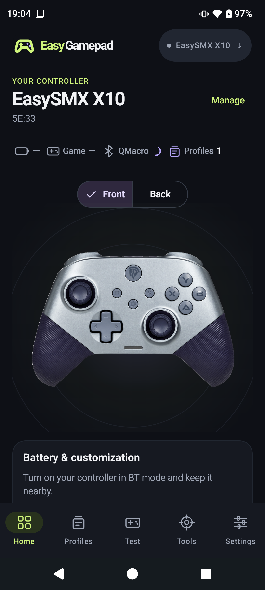
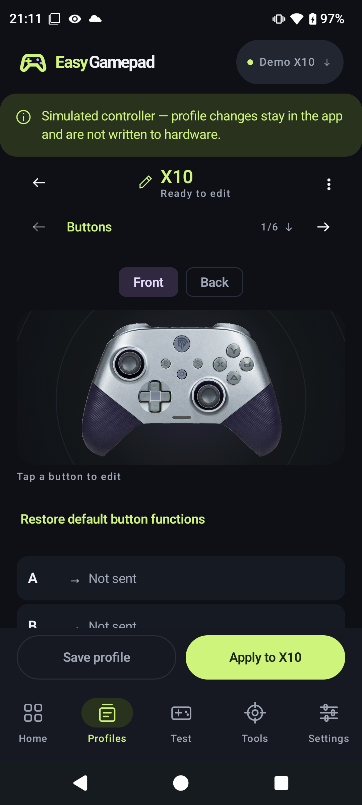

# EasyGamepad

Test your gamepad and customize your EasySMX X10 from Android.

EasyGamepad shows the buttons, sticks and triggers reported by Android gamepads.
For the **EasySMX X10**, it also connects to the controller's separate
**QMacro / KRLY Bluetooth LE channel** for battery readings, profiles and
controller settings.

  
  
  

## What you can do

- **Test Android gamepads:** inspect live buttons, stick movement and trigger travel.
- **Customize the X10:** remap buttons, adjust stick and trigger ranges, reverse
  stick axes, build rear-paddle macros, configure turbo and set motor intensity.
- **Keep profiles:** save setups on your phone and import or export JSON files.
- **Manage controllers:** switch between devices and give them local names.
- **Maintain your X10:** follow calibration instructions, read version information
  and inspect connection diagnostics.
- **Choose your appearance:** dark, light or system theme; English or Brazilian Portuguese.

## Compatibility and getting started

Requires **Android 8.0 or later**. Generic Bluetooth and USB gamepads can use the
input tester when Android exposes their inputs. Advanced configuration currently
supports the **EasySMX X10**. The **EasySMX X20** and **X20 Pro** are identified and
their settings read and changed over KeyLinker, each change confirmed by reading it back (see [KeyLinker protocol](docs/keylinker.md)).
Other EasySMX models do not automatically share that support.

1. Install an EasyGamepad APK, or [build it from source](CONTRIBUTING.md#build-and-install).
2. Connect your controller to Android through Bluetooth or USB for input testing.
3. For X10 settings and battery, add an **EasySMX X10** in the controller picker
   and connect its configuration peripheral. Grant the requested Bluetooth permissions.
4. Edit a setup in **Profiles**. **Save profile** keeps a phone copy;
   **Apply to X10** sends it to the controller.

Gameplay and configuration are separate connections. If the tester works but
battery and settings are unavailable, check the configuration connection. QMacro
may already be connected to another phone.

See the **[illustrated user guide](docs/user-guide.md)** for setup, features,
limitations and troubleshooting. Controller write and calibration paths are
implemented; validation of every setting and its persistence across controller
restarts remains incomplete.

## Documentation and development

| Read this | For |
| --- | --- |
| [User guide](docs/user-guide.md) | Connecting, testing and customizing your controller |
| [KRLY protocol reference](docs/protocol.md) | Frames, commands, responses and worked examples |
| [Development guide](docs/development.md) | Architecture, profiles, diagnostics and adding support |
| [Contributing](CONTRIBUTING.md) | Build requirements, installation and checks |

Browse the [documentation index](docs/README.md) for project policies and credits.

## Why EasyGamepad exists

EasyGamepad began with an X10 whose official companion app installed on a newer
Android phone but could no longer connect. The project provides an independent,
open-source way to keep that hardware useful, with a native Kotlin and Jetpack
Compose app and a separate, testable protocol module.

## Privacy and license

No account, ads or analytics. The app has no Internet permission. Preferences and
saved profiles stay on your phone; Android backup is disabled. Export profiles
before uninstalling. Connection history stays in memory unless you share it.

Copyright © 2026 Edgard. Licensed under **[GPL-3.0-or-later](LICENSE)**.
X10 artwork and layout data come from **[x20ctl](https://github.com/AmjadAAYD/x20ctl)**;
see [NOTICE](NOTICE) and [third-party credits](THIRD_PARTY.md).

EasyGamepad is an independent project, not affiliated with EasySMX or x20ctl.
Product names belong to their respective owners.
