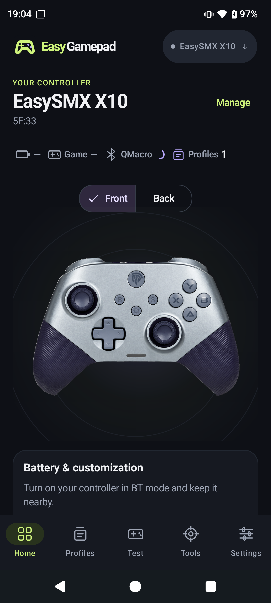
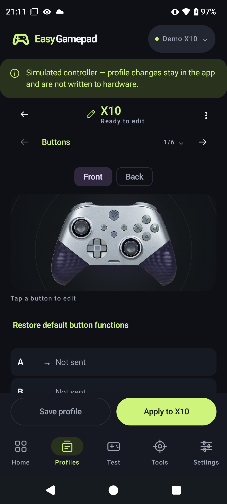
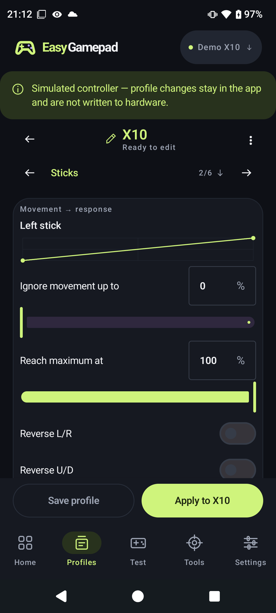
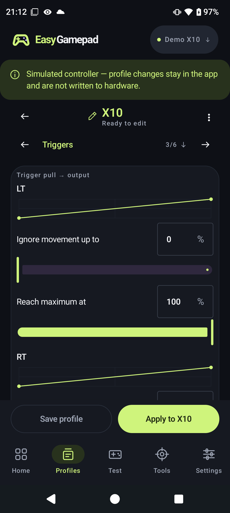
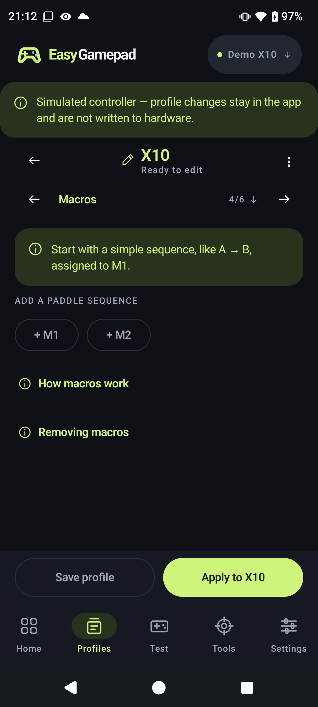
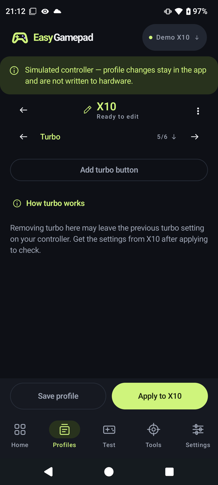
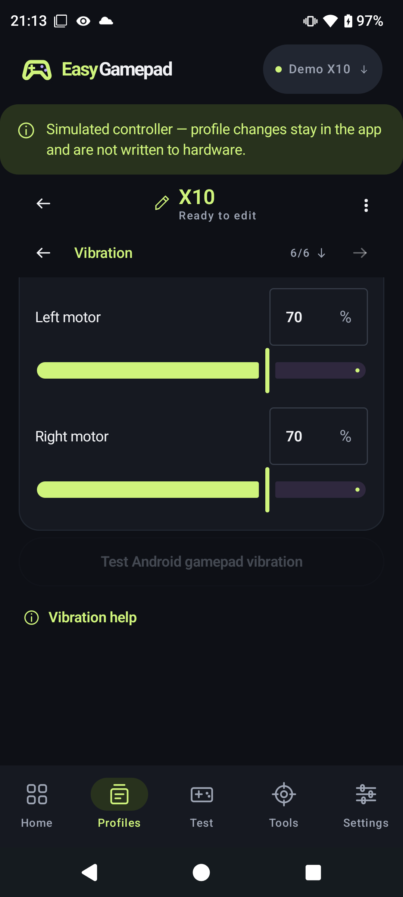

# EasyGamepad user guide

EasyGamepad tests gamepads through Android and provides advanced configuration
for the EasySMX X10. The screenshots below show the Android app in English with
the dark theme. Battery readings and connection states are real observations;
editor values are local drafts, not proof that those settings were applied.

Jump to [setup](#install-and-connect), [input testing](#test-a-gamepad),
[profiles and customization](#work-with-profiles), [controller tools](#controller-tools),
[preferences](#preferences-and-privacy) or [troubleshooting](#troubleshooting).

## Install and connect

### Requirements

- Android 8.0 or later.
- A Bluetooth or USB gamepad recognized by Android for input testing.
- An EasySMX X10 with its configuration BLE channel available for customization.

Install an EasyGamepad APK on your phone. For a local build and ADB installation,
follow [Contributing](../CONTRIBUTING.md#build-and-install). Android may ask you to
allow installation from the app used to open the APK.

### Understand the two connections

| Connection | What it enables | How to connect |
| --- | --- | --- |
| Gameplay: Android gamepad input | Games and the live input tester | Android Bluetooth pairing or USB |
| Configuration: X10 QMacro / KRLY BLE | X10 battery, settings, profiles, calibration and version queries | EasyGamepad's connection flow |

The X10 can appear as **Xbox Wireless Controller** for gameplay and **QMacro**
for configuration. Names and addresses can differ. Seeing inputs in **Test**
does not establish the configuration connection.

1. Put the X10 in **BT** mode and turn it on. Pair its gameplay connection in
   Android's Bluetooth settings if you want to play or test input.
2. Open the controller picker at the top of EasyGamepad and choose **Add EasySMX X10**.
3. Allow the requested permissions. On Android 12+, these are **Nearby devices**.
   On Android 8–11, BLE scanning also needs Location permission and Location enabled.
4. In **Connect to the app**, choose **Find X10**, then select the configuration
   peripheral, typically QMacro. Disconnect QMacro on other phones first.
5. Wait for **App connected**. The app checks the GATT service and characteristics
   and enables notifications before accepting configuration commands.

For a saved X10, use **Connect to app** on Home when disconnected. A saved entry
marked **Saved · waiting for a signal** is not evidence that the device is nearby.

### Home and controller selection

Home shows the selected controller, its gameplay and configuration states, and
battery when available. Tap the battery card to refresh. An unavailable battery
reading is not displayed as 0%.

*Home with the X10 connected for gameplay and configuration.*

Use **Manage** or the top controller picker to switch devices or **Rename** one.
The name changes only in EasyGamepad. Switching the selected controller closes
the previous configuration session; Android gameplay pairing remains independent.
Finish an active operation or calibration before switching.

If the X10 and its gameplay input are not linked, use **Which controller do you
want to test?** in the picker. With several similar controllers, explicitly choose
the matching input. With exactly one saved X10 and one Android gamepad, the app
can use that sole input automatically for the current situation.

Generic gamepads get the input tester. **Profiles** and **Tools** require a
supported configuration profile. Selecting an Xbox-style device name does not
make it an X10 or enable the X10 command set.

### Reconnection

While EasyGamepad is in the foreground, it can retry the selected X10's previously
verified configuration address when the link is disconnected. Switching away with
an idle, ready configuration session keeps that GATT link open so you can return
without reconnecting. Leaving during an active calibration or macro upload runs
cleanup and disconnects BLE; closing the app entirely also releases the link.
Returning to the foreground allows reconnect attempts again (unless you used
**Disconnect from app**).

**Disconnect from app** pauses automatic reconnection until you reopen the app.
It does not unpair the gameplay connection. Keep the app open throughout any
operation that needs the configuration connection.

## Test a gamepad

Open **Test**, select the correct controller and press its buttons or move its
sticks. EasyGamepad shows only the input Android delivers to the selected device.

*The live view and the input measurements farther down the same screen.*

- Switch between **Front** and **Rear paddles** for the X10 illustration.
- Inspect both stick plots and their separate movement trails. The displayed
  offset helps inspect drift; the tester does not add a software dead zone.
- Check digital LB/RB and gradual LT/RT travel. Digital trigger modes may jump
  straight to 100%.
- Button outlines record which buttons have been tested. **Clear** or **Clear test**
  resets the selected test, not the controller's hardware settings.
- Expand **Technical details**, when available, for raw axes and device identifiers.

In the rear view, **Identify rear paddles** associates M1 or M2 with the Android
button event it currently produces. If M1 repeats A, both can light up together.
This is a temporary testing aid; it does not reprogram the paddle or distinguish
two physical buttons that send the same event. The tester does not inject input
or remap controls in other apps.

## Work with profiles

Open **Profiles** with an X10 selected. Changes begin as a local draft.
Swipe the section tabs horizontally to reach **Turbo** and **Vibration** on a
narrow screen. Scroll vertically to see both sticks or triggers and file actions;
**Save profile** and **Apply to X10** stay in the bottom action bar.

| Action | Result |
| --- | --- |
| Edit controls | Changes the current draft |
| Save profile | Adds a saved copy on this phone, up to 30 profiles |
| Update saved | Overwrites the saved copy you loaded, after confirmation |
| Load a saved profile | Replaces the draft after confirmation |
| Apply to X10 | Sends the draft to the connected X10 after confirmation |
| Export profile | Writes the draft to a JSON file you choose |
| Import profile from a file | Loads a compatible JSON file into the draft |

Saving, loading and importing do not apply settings to the controller. Exporting
does not add a saved phone profile. Drafts are separate for each selected
controller during the app session; save or export work you want to keep.

### Read the current X10 settings

Tap **Read from X10**, beside the draft name, and confirm **Read from X10**.
Save your draft first if you want to keep its existing values.

The read replaces **face mappings, M1/M2 rear remaps, rear-paddle macros,
disabled-paddle state**, stick ranges and axis inversion, trigger ranges, motor
intensities and turbo entries. It keeps the local **profile name** and any **M3/M4**
macro sequences present only in the draft model (the X10 editor works with
physical M1/M2). A read is not a complete backup of every onboard rule, and it
does not prove persistence after power-off.

### Buttons

Tap a button in the illustration to choose its output. Switch to **Back** for M1
and M2, or scroll to **Show button list** for a list editor. **Restore standard
output** restores a regular button in the draft. M1/M2 without a mapping, macro
or disabled state are omitted on apply, leaving the controller's current slot
untouched. **Disable paddle** marks M1 or M2
disabled in the draft; apply sends an explicit clear so the paddle produces no
output. A paddle cannot carry both a rear remap and a macro: assigning one after
the other opens a confirmation because the change replaces the existing setup.
Cancel leaves the draft unchanged. If you switch profiles, rename the draft or
edit elsewhere while a confirmation is open, the pending dialog is discarded when
its captured draft revision no longer matches.

*Button editing stays local until you apply the profile.*

### Sticks

Adjust each stick's minimum and maximum range and optionally reverse its
horizontal or vertical axis. The response preview explains the range: ignore
movement below the minimum and reach full output at the maximum. It represents
range tuning, not an arbitrary editable response curve.

### Triggers

Set independent minimum and maximum ranges for LT and RT. Ranges use percentages
from 0 to 100, with the minimum strictly below the maximum. Test slow, full travel
in **Test** to understand your controller's current trigger mode.

### Macros

Choose **+ M1** or **+ M2** to add a rear-paddle sequence. Each step has one button,
a **Hold (ms)** duration and a **Wait (ms)** duration. Add up to 32 steps per paddle;
use the step's button picker, move-up action or remove action to edit it.
**Repeat sequence** changes the repeat setting in the draft. **Remove macro**
marks that paddle **disabled** in the draft, but you can
assign a new remap or macro afterward without leaving the editor.

Hold duration must be 1–65,535 ms; wait duration can be 0–65,535 ms. A sequence
needs at least one valid step before the profile can be saved or applied.

*A local example, prepared for this screenshot without applying it to the X10.*

### Turbo

Choose **Add turbo button**, select a button, set the rate from 1 to 20 and choose
whether to enable **Automatic turbo**. Use **Remove** to delete an entry from the
draft. The rate is the controller's protocol value; the app does not verify a
precise presses-per-second measurement.

### Vibration

Set the left and right motor intensities independently, from 0 to 100%.
These sliders edit the draft; use **Apply to X10** to store them on the controller.

While the X10 configuration channel is ready, hold and drag either motor slider
to feel that motor at the chosen intensity through that connection. Releasing the
slider stops the preview. These live previews work independently of Android
gamepad vibration and do not store the selected intensity or apply the profile.
Connect the configuration channel and finish any active operation or calibration
to enable them. If vibration continues after you release the slider, turn the
controller off before reconnecting.

**Test Android gamepad vibration** uses the selected Android input device's
vibrator, if exposed by that device. It does not apply the draft motor settings;
availability depends on Android and the controller.

The Android test is disabled with an explanation when no gameplay device is selected or
Android exposes no vibrator for it. This can happen even when the X10's separate
configuration connection can read and change motor intensity. On Android 12 and
later the app uses the selected input device's vibrator manager; it never falls
back to vibrating the phone or a different controller. Use the X10 motor sliders
instead when Android vibration is unavailable. Motor selection and
changes in test intensity were physically checked on one X10; other firmware
versions have not been verified.
The evidence and remaining protocol limits are in [X10 vibration](x10-vibration-investigation.md).

### Apply and verify

Connect the configuration channel, check the draft, choose **Apply to X10** and
confirm. Keep the controller nearby and the app open until it reports the result.
Application stops on a failure and may leave some settings already changed.
There is no automatic rollback.

A controller acknowledgment confirms a command response, not persistence after
power-off. Verify the behavior in **Test**, read back supported settings, and
check again after restarting the controller when persistence matters. Omitted
face mappings, unconfigured rear paddles and omitted turbo entries are not sent as
erase commands; onboard rules may remain until you replace them explicitly.
**Disable paddle** and explicit M1/M2 remaps or macros are sent and participate in
read-back comparison. See
[X10 read-back validation](x10-readback-validation.md) for what apply compares after upload.

The write and calibration paths are implemented, but complete physical validation
of every setting, removal behavior and persistence remains outstanding.

### Import, export and storage

Use **Export profile** to keep a portable copy before uninstalling. Imports must
use the current `easygamepad-profile` format, version 1, for `easysmx-x10`.
Renamed or older format identifiers are not accepted by the current importer.
Older exports without **`disabledRearPaddles`** still import; the field defaults
to none disabled. See the [file format](development.md#profile-file-format) for a complete example.

Saved profiles and preferences stay on this phone. Android backup is disabled;
uninstalling removes local data. Loading or deleting a saved profile requires
confirmation. Deleting it does not reset the controller.

## Controller tools

Open **Tools** with an X10 selected and its configuration connection ready.

*Calibration instructions before starting a session.*

### Calibration

Select **Analog sticks**, **Triggers** or **Self-calibration**. Read the on-screen
steps before choosing **Start calibration** and confirming.

| Type | What to do |
| --- | --- |
| Analog sticks | Release both sticks, start, slowly rotate both through their full range, release them and wait for the result |
| Triggers | Release LT/RT, start, slowly press and release both fully several times, then wait |
| Self-calibration | Place the controller flat on a stable surface and leave all controls untouched |

The controller reports success or requests a retry. After success, choose
**Finish calibration**. **Stop calibration** ends an unfinished session and is
not a successful result. Sessions have a 90-second limit. Leaving the app during
calibration attempts to stop calibration and disconnect BLE; radio loss can
prevent cleanup. If the
controller remains in calibration mode, reconnect or power-cycle it before retrying.

### Version, diagnostics and factory settings

- **Check version** reads controller version information. Expand **Technical details**
  for hardware, protocol and project fields. This does not update firmware.
- **Connection diagnostics → View** shows recent connection history.
  **Share history** opens Android sharing; review addresses and payloads before
  sharing publicly. **Clear** clears the in-memory history.
- **Reset controller** is a separate, confirmed factory-reset action. It changes
  the X10's onboard settings; saved phone profiles remain. Export what you need
  first, remembering that settings readback does not recover macro sequences.

Firmware flashing, lighting configuration and free-form response curves are not
available in this version.

## Preferences and privacy

In **Settings**, choose **Dark**, **Light** or **System** appearance. Set language
to **Automatic**, **English** or **Português (Brasil)**. Automatic follows supported
device languages and falls back to English.

**Connection & permissions** provides permission help. For supported controllers,
**Advanced connection** exposes service, write and notify UUIDs. Change these only
with device-specific instructions; changes take effect on the next connection.
**About EasyGamepad** contains the version, links and offline license notices.

The app has no account, ads, analytics or Internet permission. Profiles and
preferences are stored locally; connection history is kept in memory until shared.

## Troubleshooting

| Symptom | What to check |
| --- | --- |
| Test works, but battery and settings do not | Connect QMacro in the app; gameplay alone does not provide KRLY configuration |
| QMacro is missing or cannot connect | Wake the X10 in BT mode; disconnect QMacro from another phone and close competing companion apps; search again |
| Search finds nothing | Allow Nearby devices; on Android 8–11 also allow Location and enable Location; verify Bluetooth is on |
| A saved controller has no nearby signal | A saved record can remain after the controller sleeps; wake it and retry |
| The wrong controller appears in Test | Select the matching device and explicitly link its gameplay input in the picker |
| Profiles or Tools are missing | These require a supported configuration profile; generic Android gamepads use Test |
| Apply is unavailable | Check connection, valid draft values and whether another operation or calibration is active |
| A command times out | Reconnect before retrying; the app closes the session so a late response cannot confirm a later command |
| Android vibration test is unavailable | The selected gamepad may not expose a vibrator through Android; move the X10 motor sliders with its configuration connection |
| X10 motor tests are unavailable | Connect the selected X10 configuration channel and finish any active operation or calibration |
| A profile cannot be imported | Check its format, version, device identifier and value ranges; see the development guide |

For persistent problems, report the app version, Android version, controller model,
firmware if readable, and which connection failed. See [Contributing](../CONTRIBUTING.md#report-a-problem).
